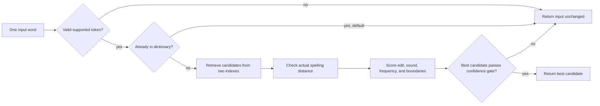
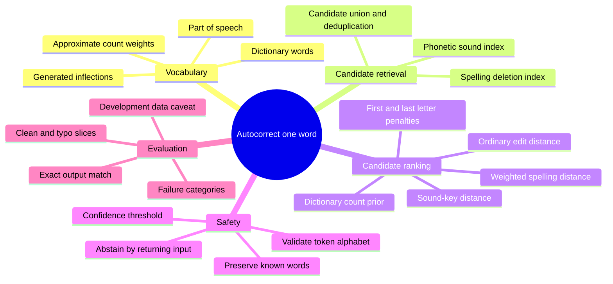
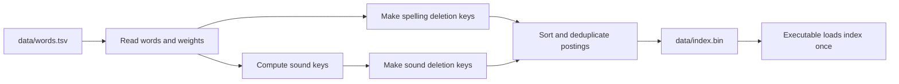

# How this autocorrect system works

This document explains the project from first principles. It is written for
someone who has not studied spelling correction algorithms and needs to explain
this implementation to the hackathon organizers. The implementation details
and code snippets below are taken from `src/autocorrect.cpp` and the data
generation tools. The source code is the final authority if a detail changes.

## The problem in one sentence

Given one possibly misspelled word, choose the intended word from a dictionary
without seeing the sentence around it.

For example:

```text
input:     speling
output:    spelling
```

The system must solve two different problems:

1. **Find plausible words** without comparing the input to every dictionary
   word.
2. **Choose the most plausible word** when several candidates look similar.

These are called *candidate retrieval* and *candidate ranking*. Keeping them
separate makes errors easier to understand: the right answer can be absent from
the candidates, or it can be present but ranked below a wrong answer.

## The full system at a glance



The executable is deterministic and offline. It does not use a neural network,
an online service, sentence context, or random sampling. For the default
configuration it reads a dictionary index, processes each input line, and
prints exactly one output line for each input line.

## A mind map of the ideas



## 1. Start with a dictionary

An autocorrector needs a set of words that it is willing to suggest. If the
intended answer is not in that set, no ranking trick can produce it.

The bundled dictionary has **161,847 entries**. It starts from a normalized
WordNet/Webster vocabulary and adds grammatical forms such as plurals and verb
forms. The generator uses part-of-speech membership and WordNet's irregular
form lists to avoid applying some regular rules where an exception exists.
For example, an irregular form like `went` comes from the exception data rather
than a rule that guesses it from `go`.

Simplified view of the real generation loop:

```python
for word in words_with_part_of_speech("verb"):
    forms = regular_verb_forms(word)
    exceptions = wordnet_exceptions(word)
    forms = remove_conflicting_regular_forms(forms, exceptions)
    dictionary.update(forms | exceptions)
```

Each dictionary entry also has a positive integer **weight**. This weight is a
rough preference signal: candidates with larger weights can win close ranking
decisions. It is derived from dictionary/sense evidence and smoothed for
generated inflections; it is **not** a reliable modern corpus frequency.

The generator reads dictionary and morphology sources, not the benchmark's
input/answer pairs. This matters because memorizing test answers would not
demonstrate a general correction algorithm.

## 2. Why not compare against every word?

For a small dictionary, comparing each input against every word is simple. For
this dictionary and a long input file it wastes work. The project first builds
indexes so a typo can quickly find a smaller set of likely candidates.

It uses two complementary clues:

* **Spelling shape:** words that can be made alike by deleting a small number
  of letters may be close spellings.
* **Approximate sound:** different spellings may sound similar, as with `phone`
  and `fone`.

Both indexes retrieve candidates. Neither is trusted to make the final
decision; each candidate is checked against the original strings later.

### 2a. Deletion signatures (SymSpell-inspired retrieval)

For a word, make signatures by deleting zero, one, or two characters. For
example, some signatures of `cat` are `cat`, `at`, `ct`, `ca`, `t`, `a`, and
`c`. If two words share a deletion signature, they may be close under edit
distance. This is a quick way to find likely neighbors without testing every
possible edit operation against the entire dictionary.

This implementation indexes deletion signatures for the first seven letters
of each dictionary word. At query time it does the same for the input, looks
up shared signatures, then checks the full words with edit distance. The
seven-letter limit keeps the index compact; it is a retrieval shortcut, not a
claim that only the first seven letters matter.

Core idea, simplified from `deletes()`:

```cpp
keys = {hash(word)};
for each character position i:
    keys.add(hash(word with character i removed));
    for each later position j:
        keys.add(hash(word with i and j removed));
```

The program stores hashes instead of full deletion strings to save index
space. A hash is only a lookup key: after retrieval, the full candidate text is
used for all distance checks, so a hash match alone never causes a correction.

This is **SymSpell-inspired**, not a claim that the project is the SymSpell
library. The project has its own index, limits, ranking and confidence rules.

### 2b. A hand-built phonetic key

Spelling is not sound. `phone` and `fone` differ at the beginning, but English
readers usually pronounce them similarly. The system maps words to a compact
sound-like key to help retrieve such candidates.

The shipped contextual encoder applies selected spelling rewrites (for
example `sch` to `sk`, `tion` to `shn`, and `tch` to `ch`), then folds letters
into broad sound groups. The lower-level encoder, simplified:

```cpp
if (letters == "ph") emit('F');
else if (letters == "sh" || letters == "ch") emit('X');
else if (letter == 'c') emit(next_is_e_i_or_y ? 'S' : 'K');
else if (letter == 'g') emit(next_is_e_i_or_y ? 'J' : 'K');
else if (letter is a vowel) skip_it();
else emit(broad_consonant_class(letter));
```

Adjacent repeated output symbols are collapsed. Thus the sound key is a rough
indexing feature, **not** an actual pronunciation, IPA transcription, or
Double Metaphone implementation. Its job is to find extra candidates that
spelling-only retrieval might miss.

At index-building time, each dictionary word contributes its sound key and
one-character deletions of that key. At run time, the program looks up the
input's sound key and (for longer words) its one-character-deletion keys. The
default caps very broad sound-key buckets so that retrieval stays bounded.

## 3. Check how different each candidate is

Retrieval is deliberately generous. A shared key can produce a bad candidate,
so the system measures actual differences before ranking.

### Ordinary edit distance

The ordinary distance is an **optimal string alignment** distance. It counts
insertions, deletions and substitutions as one edit, and also treats swapping
two neighboring letters as one edit.

Example:

```text
speling -> spelling
         insert one "l" = 1 edit
```

Tiny dynamic-programming example (concept only):

```text
D[i,j] = cheapest edits to change first i input letters
         into first j candidate letters

D[i,j] = min(
    D[i-1,j]   + 1,                 delete an input letter
    D[i,j-1]   + 1,                 insert a candidate letter
    D[i-1,j-1] + (letters differ)   keep or substitute
)
```

The code adds a neighboring-letter transposition case, so `teh` to `the` is
one edit. This raw distance is easy to interpret, but it treats every letter
change alike.

### Weighted spelling distance

Some spelling mistakes are more plausible than others. A keyboard neighbor is
easy to hit accidentally. A missing repeated letter is common. Some sound
patterns have multiple conventional spellings. The weighted distance gives
these changes different costs.

The program's dynamic program considers the same insert/delete/substitute/
transpose operations, but with nonuniform costs. The default also includes
reusable spelling/sound rules such as `ph` ↔ `f`, `ck` ↔ `k`, selected vowel
pairs, and position-limited silent-letter patterns. These rules apply to
character sequences, not individual benchmark words.

Conceptual example:

```text
ordinary distance:    one edit costs 1
weighted distance:    a likely spelling variation may cost less than 1
```

The exact rules and costs are in `rules()`, `gap()`, and
`weighted_distance()` in `src/autocorrect.cpp`. They are heuristics; a lower
cost means “the system considers this edit more plausible,” not “this is
linguistically proven.”

## 4. Combine evidence to rank candidates

At this point the system has a list of plausible dictionary words. It computes
a score for each. **Lower is better.** The shipped score is:

```text
score = 0.5 * weighted spelling cost
      + 0.5 * ordinary edit distance
      + 0.15 * sound-key distance
      - 0.08 * log(1 + dictionary weight)
      + 0.25 if first letters differ
      + 0.15 if last letters differ
```

This is a balance of evidence:

| Signal | What it says | Why it helps |
| --- | --- | --- |
| Weighted spelling cost | How plausible are the specific edits? | Discounts common spelling patterns and nearby keys. |
| Ordinary edit distance | How many basic edits separate the strings? | Stops a low-cost rule from making a very different word look too close. |
| Sound-key distance | How different are the rough sound keys? | Helps when spelling differs but sound is similar. |
| Dictionary weight | How established is this candidate in the source lexicon? | Breaks some close ties in favor of better-supported words. |
| First/last letter penalties | Did the candidate change a word boundary? | Adds a small preference for preserving the beginning and ending. |

The dictionary weight is only a weak prior. It can also cause mistakes when a
common wrong candidate competes with a rarer intended answer. That is visible
in the failure report, for example `spund` where `spend` outranks `spun`.

The exact implementation sorts by score, then breaks ties by larger dictionary
weight, then alphabetically. This makes repeated runs deterministic.

## 5. Preserve safe inputs and abstain when unsure

Aggressive correction can make a correct word wrong. The default therefore
preserves exact dictionary words. That is a deliberate safety tradeoff: without
sentence context, a real-word typo such as `form` instead of `from` is
indistinguishable from a correctly typed `form`.

The program also preserves unsupported tokens (not lowercase ASCII letters or
apostrophes), tokens shorter than three characters, and tokens longer than 64
characters. If a typo has no sufficiently plausible candidate, the output is
the original input. In machine-learning terminology this is sometimes called
abstaining; here it simply means “leave the word alone.”

For a non-word input, the default correction gate requires the best candidate's
weighted cost to be at most `min(3.2, 1.05 + 0.2 * input_length)`. It also
requires either no more than two raw edits or a margin of at least `0.12`
between the best candidate and the runner-up. A margin helps avoid making a
correction when the top two choices are nearly tied.

In code, the final decision is essentially:

```cpp
if (best.weighted_cost <= length_based_limit &&
    (best.raw_edits <= 2 || best_score_margin >= 0.12)) {
    return best.word;
}
return input; // no candidate was confident enough
```

The full code has extra guards for known-word experiments and short inputs.
Those options are off in the shipped default.

## 6. The indexes are built before the program runs

The runtime does not rebuild the dictionary indexes for every input. `./build.sh`
compiles the C++ program and serializes the words, weights and sorted posting
lists to `data/index.bin`:



The index header identifies the encoder version. This prevents building an
index with one sound-key algorithm and accidentally querying it with another.
The binary format uses explicit little-endian integers rather than writing
compiler-specific in-memory structures directly.

## 7. One complete input, step by step

Take an unknown input like `speling`:

1. Check that the token is supported and not an exact dictionary entry.
2. Make deletion signatures from its first seven letters and retrieve words
   sharing signatures in the spelling index.
3. Make a sound key, retrieve words from the sound index, and merge duplicate
   candidate IDs.
4. Compute raw spelling edits, sound-key edits and weighted spelling cost for
   each retrieved candidate.
5. Drop candidates that fail length, edit and sound filters.
6. Calculate the combined score and sort candidates.
7. If the winner passes the confidence gate, emit it; otherwise emit `speling`
   unchanged.

This is why having a good dictionary is necessary but not sufficient. The
target has to be retrieved, survive filtering, win the ranking, and pass the
confidence gate.

## 8. How we measure whether it works

The evaluator compares each output to the expected word using exact string
equality. If there are 2,000 rows and 1,828 exact matches, accuracy is
`1,828 / 2,000 = 91.4%`. It also reports clean-word preservation separately
from misspelling accuracy, and records runtime, memory and file hashes.

The final default run was:

| Dataset | Exact matches | Accuracy | Clean-word preservation | Typo accuracy | Runtime | Peak memory |
| --- | ---: | ---: | ---: | ---: | ---: | ---: |
| Hackathon public development | 1,828 / 2,000 | 91.40% | 95.75% | 90.31% | 1.225 s | 162.18 MiB |
| Birkbeck | 14,412 / 35,267 | 40.865% | 98.67% | 40.74% | 10.886 s | 164.92 MiB |

The original implementation scored 72.60% on hackathon and 39.694% on
Birkbeck. The final version fixes 415 hackathon rows that the original got
wrong, while regressing 39. **The 99% hackathon target was not reached.** Both
datasets were used repeatedly for development and debugging, so these are
development results, not an unbiased estimate of performance on unseen data.

The hackathon final failures are mostly **ranking** failures: the intended
candidate is present but another candidate wins. There are also missing
dictionary words and a small number of known-word preservation, retrieval and
confidence-gate failures. On Birkbeck, broader retrieval helps, but there are
many extremely unusual errors and conflicting references. Because the program
has no sentence context, the same input cannot be mapped correctly to two
different targets; Birkbeck's input-only upper bound is 94.11%.

## 9. What the system is—and is not

**It is:**

* A deterministic, offline, single-word corrector.
* A dictionary-based candidate retriever with spelling and sound indexes.
* A hand-engineered ranker using edit distance, spelling rules and count
  weights.
* A system that can leave uncertain or already-valid inputs unchanged.

**It is not:**

* A sentence-aware grammar checker or language model.
* A neural or other trained ML system.
* A complete English pronunciation engine.
* A guarantee that every correction is right.
* A claim of 99% accuracy or of outperforming established libraries such as
  Hunspell, Aspell, or SymSpell in a general benchmark.

## 10. How to demonstrate it

Build and run the tests:

```sh
./build.sh
./test.sh
```

Try a correction with a visible explanation of the candidate ranking:

```sh
./autocorrect --explain speling
```

Try the line-oriented interface:

```sh
printf 'speling\nphone\n' | ./autocorrect
```

`--explain` shows each candidate's raw edit distance, sound-key distance,
weighted cost, dictionary weight and final score. A lower final score ranks
higher. This is useful for explaining why an answer won and for diagnosing
mistakes.

To reproduce the saved evaluation style:

```sh
python3 tools/evaluate.py \
  --input hackathon_test/input.txt \
  --expected hackathon_test/expected.txt \
  --executable ./autocorrect \
  --label hackathon-development \
  --report results/new-hackathon-run.json
```

Do not use `--trace` for normal judge output: it is a diagnostic mode that
prints extra candidate rows.

## A short explanation for the organizers

> Our system corrects one word at a time using a local dictionary. It first
> retrieves possible corrections through two complementary indexes: one based
> on shared spelling deletions, and another based on a hand-built approximate
> sound key. It then checks real edit distances and ranks candidates using
> weighted spelling changes, sound similarity, dictionary support, and small
> word-boundary penalties. It preserves known words and leaves an uncertain
> typo unchanged. The implementation is deterministic, offline, and does not
> use a trained model or sentence context. On our 2,000-row public development
> set it scored 91.4%, up from the original 72.6%; we did not reach our 99%
> target, and the development set was used during iteration.

## Further reading in this repository

* `ALGORITHM_GUIDE.md` — exact phonetic rules, scores, thresholds, and source
  map.
* `ITERATION_REPORT.md` — experiments, comparisons, failure causes, and why
  the final configuration was selected.
* `results/iterations/hackathon-final-analysis.json` — candidate-level
  hackathon failures.
* `results/iterations/summary.json` — measured experiment configurations.
