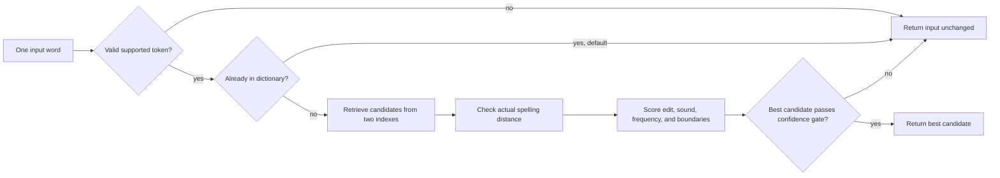
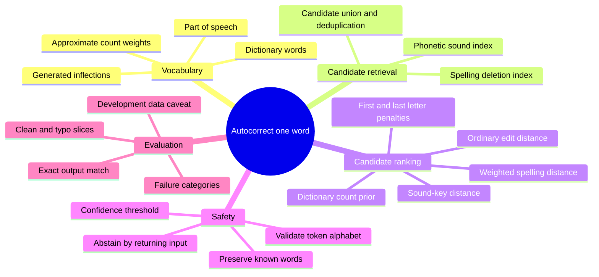
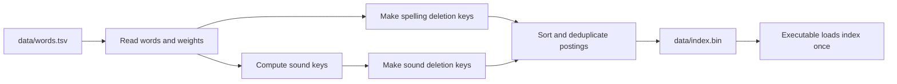
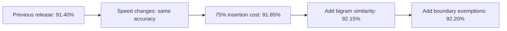

# How this autocorrect system works

This document explains the project from first principles. It is written for
someone who has not studied spelling correction algorithms and needs to explain
this implementation to the hackathon organizers. The implementation details
and code snippets below are taken from `src/autocorrect.cpp` and the data
generation tools. The source code is the final authority if a detail changes.

**Submission status:** exploration has stopped. The previously best measured
configuration is now the default: 75% insertion cost, bigram weight 0.5, and
boundary-transposition exemptions. A fresh default run reproduced
**92.20% (1,844/2,000)** on hackathon in **0.592206 seconds**.
The 99% target was not reached. The unit checks and all 17 Python tests pass.
The archive contains source and an offline build script; Linux execution has
not been verified here. Earlier iteration measurements below are preserved as
historical records.

## The problem in one sentence

Given one possibly misspelled word, choose the intended word from a dictionary
without seeing the sentence around it.

For example:

```text
input:     speling
output:    spelling
```

The system must solve two different problems:

1. **Find plausible words** without comparing the input to every dictionary
   word.
2. **Choose the most plausible word** when several candidates look similar.

These are called *candidate retrieval* and *candidate ranking*. Keeping them
separate makes errors easier to understand: the right answer can be absent from
the candidates, or it can be present but ranked below a wrong answer.

## The full system at a glance



The executable is deterministic and offline. It does not use a neural network,
an online service, sentence context, or random sampling. For the default
configuration it reads a dictionary index, processes each input line, and
prints exactly one output line for each input line.

## A mind map of the ideas



## 1. Start with a dictionary

An autocorrector needs a set of words that it is willing to suggest. If the
intended answer is not in that set, no ranking trick can produce it.

The bundled dictionary has **161,847 entries**. It starts from a normalized
WordNet/Webster vocabulary and adds grammatical forms such as plurals and verb
forms. The generator uses part-of-speech membership and WordNet's irregular
form lists to avoid applying some regular rules where an exception exists.
For example, an irregular form like `went` comes from the exception data rather
than a rule that guesses it from `go`.

Simplified view of the real generation loop:

```python
for word in words_with_part_of_speech("verb"):
    forms = regular_verb_forms(word)
    exceptions = wordnet_exceptions(word)
    forms = remove_conflicting_regular_forms(forms, exceptions)
    dictionary.update(forms | exceptions)
```

Each dictionary entry also has a positive integer **weight**. This weight is a
rough preference signal: candidates with larger weights can win close ranking
decisions. It is derived from dictionary/sense evidence and smoothed for
generated inflections; it is **not** a reliable modern corpus frequency.

The generator reads dictionary and morphology sources, not the benchmark's
input/answer pairs. This matters because memorizing test answers would not
demonstrate a general correction algorithm.

## 2. Why not compare against every word?

For a small dictionary, comparing each input against every word is simple. For
this dictionary and a long input file it wastes work. The project first builds
indexes so a typo can quickly find a smaller set of likely candidates.

It uses two complementary clues:

* **Spelling shape:** words that can be made alike by deleting a small number
  of letters may be close spellings.
* **Approximate sound:** different spellings may sound similar, as with `phone`
  and `fone`.

Both indexes retrieve candidates. Neither is trusted to make the final
decision; each candidate is checked against the original strings later.

### 2a. Deletion signatures (SymSpell-inspired retrieval)

For a word, make signatures by deleting zero, one, or two characters. For
example, some signatures of `cat` are `cat`, `at`, `ct`, `ca`, `t`, `a`, and
`c`. If two words share a deletion signature, they may be close under edit
distance. This is a quick way to find likely neighbors without testing every
possible edit operation against the entire dictionary.

This implementation indexes deletion signatures for the first seven letters
of each dictionary word. At query time it does the same for the input, looks
up shared signatures, then checks the full words with edit distance. The
seven-letter limit keeps the index compact; it is a retrieval shortcut, not a
claim that only the first seven letters matter.

Core idea, simplified from `deletes()`:

```cpp
keys = {hash(word)};
for each character position i:
    keys.add(hash(word with character i removed));
    for each later position j:
        keys.add(hash(word with i and j removed));
```

The program stores hashes instead of full deletion strings to save index
space. A hash is only a lookup key: after retrieval, the full candidate text is
used for all distance checks, so a hash match alone never causes a correction.

This is **SymSpell-inspired**, not a claim that the project is the SymSpell
library. The project has its own index, limits, ranking and confidence rules.

### 2b. A hand-built phonetic key

Spelling is not sound. `phone` and `fone` differ at the beginning, but English
readers usually pronounce them similarly. The system maps words to a compact
sound-like key to help retrieve such candidates.

The shipped contextual encoder applies selected spelling rewrites (for
example `sch` to `sk`, `tion` to `shn`, and `tch` to `ch`), then folds letters
into broad sound groups. The lower-level encoder, simplified:

```cpp
if (letters == "ph") emit('F');
else if (letters == "sh" || letters == "ch") emit('X');
else if (letter == 'c') emit(next_is_e_i_or_y ? 'S' : 'K');
else if (letter == 'g') emit(next_is_e_i_or_y ? 'J' : 'K');
else if (letter is a vowel) skip_it();
else emit(broad_consonant_class(letter));
```

Adjacent repeated output symbols are collapsed. Thus the sound key is a rough
indexing feature, **not** an actual pronunciation, IPA transcription, or
Double Metaphone implementation. Its job is to find extra candidates that
spelling-only retrieval might miss.

At index-building time, each dictionary word contributes its sound key and
one-character deletions of that key. At run time, the program looks up the
input's sound key and (for longer words) its one-character-deletion keys. The
default caps very broad sound-key buckets so that retrieval stays bounded.

## 3. Check how different each candidate is

Retrieval is deliberately generous. A shared key can produce a bad candidate,
so the system measures actual differences before ranking.

### Ordinary edit distance

The ordinary distance is an **optimal string alignment** distance. It counts
insertions, deletions and substitutions as one edit, and also treats swapping
two neighboring letters as one edit.

Example:

```text
speling -> spelling
         insert one "l" = 1 edit
```

Tiny dynamic-programming example (concept only):

```text
D[i,j] = cheapest edits to change first i input letters
         into first j candidate letters

D[i,j] = min(
    D[i-1,j]   + 1,                 delete an input letter
    D[i,j-1]   + 1,                 insert a candidate letter
    D[i-1,j-1] + (letters differ)   keep or substitute
)
```

The code adds a neighboring-letter transposition case, so `teh` to `the` is
one edit. This raw distance is easy to interpret, but it treats every letter
change alike.

### Weighted spelling distance

Some spelling mistakes are more plausible than others. A keyboard neighbor is
easy to hit accidentally. A missing repeated letter is common. Some sound
patterns have multiple conventional spellings. The weighted distance gives
these changes different costs.

The program's dynamic program considers the same insert/delete/substitute/
transpose operations, but with nonuniform costs. The default also includes
reusable spelling/sound rules such as `ph` ↔ `f`, `ck` ↔ `k`, selected vowel
pairs, and position-limited silent-letter patterns. These rules apply to
character sequences, not individual benchmark words.

Conceptual example:

```text
ordinary distance:    one edit costs 1
weighted distance:    a likely spelling variation may cost less than 1
```

The exact rules and costs are in `rules()`, `gap()`, and
`weighted_distance()` in `src/autocorrect.cpp`. They are heuristics; a lower
cost means “the system considers this edit more plausible,” not “this is
linguistically proven.”

The resumed work added a configurable **insertion scale**. When the writer omits
a letter, the corrector has to insert it to recover the intended word. Setting
`--insertion-scale .75` makes that operation cost 75% of its previous weighted
cost. Deleting an extra input letter keeps its original cost. Ordinary edit
distance stays unchanged, and multi-character spelling rules retain their
listed costs. The submission default insertion scale is `.75`.

The relevant dynamic-programming transition is:

```cpp
d[i][j - 1] + insertion_scale * gap(b, j - 1, spelling_costs)
```

Here `b` is the candidate word. Moving from its first `j-1` letters to its
first `j` letters means inserting another candidate letter. This change helps
counter the tendency to choose a shorter word when the writer actually left
out a letter.

## 4. Combine evidence to rank candidates

At this point the system has a list of plausible dictionary words. It computes
a score for each. **Lower is better.** The shipped score is:

```text
score = 0.5 * weighted spelling cost
      + 0.5 * ordinary edit distance
      + 0.15 * sound-key distance
      - 0.08 * log(1 + dictionary weight)
      + 0.25 if first letters differ
      + 0.15 if last letters differ
      + 0.5 * letter-bigram distance
```

This is a balance of evidence:

| Signal | What it says | Why it helps |
| --- | --- | --- |
| Weighted spelling cost | How plausible are the specific edits? | Discounts common spelling patterns and nearby keys. |
| Ordinary edit distance | How many basic edits separate the strings? | Stops a low-cost rule from making a very different word look too close. |
| Sound-key distance | How different are the rough sound keys? | Helps when spelling differs but sound is similar. |
| Dictionary weight | How established is this candidate in the source lexicon? | Breaks some close ties in favor of better-supported words. |
| First/last letter penalties | Did the candidate change a word boundary? | Adds a small preference for preserving the beginning and ending. |

The dictionary weight is only a weak prior. It can also cause mistakes when a
common wrong candidate competes with a rarer intended answer. That is visible
in the failure report, for example `spund` where `spend` outranks `spun`.

Candidates are ordered by score, then by larger dictionary weight, then
alphabetically. Diagnostic mode sorts the full list; normal prediction now
retains just the best two. Both use the same ordering.

### Extra ranking evidence tested in the resumed campaign

The best measured hackathon combination adds **letter-bigram similarity**. A
bigram is a neighboring pair of letters:

```text
cart -> ca, ar, rt
card -> ca, ar, rd
```

These words share two of three bigrams. The implementation sorts the bigrams
and counts the shared occurrences, including repeated pairs. Its distance is:

```text
bigram_distance = 1 - 2 * shared_occurrences / (pairs_in_input + pairs_in_candidate)
```

For the example this is `1 - 4/6 = 1/3`. A smaller result means more letter
fragments were preserved. The option `--ngram-weight .5` adds
`0.5 * bigram_distance` to the normal score. This can distinguish candidates
that have the same number of edits but preserve different parts of the input.
The submission enables it by default (`--ngram-weight .5`).

This excerpt shows how the sorted pair lists are compared:

```cpp
while (i < a.size() && j < b.size()) {
    if (a[i] == b[j]) { ++common; ++i; ++j; }
    else if (a[i] < b[j]) ++i;
    else ++j;
}
```

The same combination enables `--edge-transpositions`. Normally, changing the
first or last letter incurs a boundary penalty. If the first two or last two
letters are swapped, that option removes the corresponding boundary penalty:
the transposition already has its own edit cost. This option is enabled in the submission default. On its own it lost one hackathon answer relative to the insertion
experiment; combined with bigram ranking it gained one. That is an example of
why combinations must be measured rather than assumed to add their individual
gains.

## 5. Preserve safe inputs and abstain when unsure

Aggressive correction can make a correct word wrong. The default therefore
preserves exact dictionary words. That is a deliberate safety tradeoff: without
sentence context, a real-word typo such as `form` instead of `from` is
indistinguishable from a correctly typed `form`.

The program also preserves unsupported tokens (not lowercase ASCII letters or
apostrophes), tokens shorter than three characters, and tokens longer than 64
characters. If a typo has no sufficiently plausible candidate, the output is
the original input. In machine-learning terminology this is sometimes called
abstaining; here it simply means “leave the word alone.”

For a non-word input, the default correction gate requires the best candidate's
weighted cost to be at most `min(3.2, 1.05 + 0.2 * input_length)`. It also
requires either no more than two raw edits or a margin of at least `0.12`
between the best candidate and the runner-up. A margin helps avoid making a
correction when the top two choices are nearly tied.

In code, the final decision is essentially:

```cpp
if (best.weighted_cost <= length_based_limit &&
    (best.raw_edits <= 2 || best_score_margin >= 0.12)) {
    return best.word;
}
return input; // no candidate was confident enough
```

The full code has extra guards for known-word experiments and short inputs.
Those options are off in the shipped default.

## 6. The indexes are built before the program runs

The runtime does not rebuild the dictionary indexes for every input. `./build.sh`
compiles the C++ program and serializes the words, weights and sorted posting
lists to `data/index.bin`:



The index header identifies the encoder version. This prevents building an
index with one sound-key algorithm and accidentally querying it with another.
The binary format uses explicit little-endian integers rather than writing
compiler-specific in-memory structures directly.

### What changed to reduce wall time

The resumed implementation uses compact index header `ACIDX006`. The sound
encoder remains the same contextual encoder. The previous format stored a
hash beside every word ID. The compact format stores each distinct hash once,
with offsets into a contiguous list of word IDs:

```text
Previous:   (hash A, word 1), (hash A, word 2), (hash A, word 3)
Compact:    hash A -> start/end offsets -> [word 1, word 2, word 3]
```

The new index also stores the already-computed sound keys. It is about
**36 MiB rather than 61 MiB** for the original 161,847-word dictionary. The
loader validates the compact keys, offsets, IDs and file length. Older index
formats remain supported. `./build.sh` now builds the compact format.

The other speed changes avoid work without changing the intended scoring:

1. **A flat dictionary lookup table.** Word IDs occupy a preallocated hash
   table, avoiding an allocation for every dictionary word.
2. **Bounded edit distance.** A candidate outside the allowed edit radius will
   be rejected anyway. The dynamic program computes only the diagonal band
   that could still fit inside that radius. Within the radius it returns the
   exact OSA distance; outside it returns `cutoff + 1`.
3. **Reuse distance rows.** Three row buffers rotate by swapping pointers,
   rather than copying complete rows after every input character.
4. **Letter-set rejection.** A bit mask records which letters a word contains.
   If a candidate needs more distinct missing letters than the edit limit
   permits, it is rejected before dynamic programming. One edit can introduce
   at most one new letter, so this is a safe lower-bound check.
5. **Keep the best two candidates.** Prediction needs the winner and runner-up
   for the confidence margin. It does not need to sort every candidate.
6. **Skip expensive scores that cannot enter the best two.** Weighted edit
   costs are nonnegative. The other score terms therefore give a lower bound
   on the final score. If that lower bound is already worse than the second
   candidate, computing weighted distance cannot change the decision.

The last idea appears in the implementation as:

```cpp
if (!exhaustive && candidates.size() == 2 &&
    fixed_score > candidates[1].score + 1e-12) continue;
```

`fixed_score` includes every scoring term except weighted edit cost. The small
epsilon protects comparisons near floating-point ties. `--trace` and
`--explain` keep the full candidate computation so that debugging still shows
the complete ranked list.

Completed speed-only runs retained **1,828 hackathon** and **14,412 Birkbeck**
correct answers. The later mask run observed 0.522 s / 7.358 s, compared with
the previous release's 1.225 s / 10.886 s. Hackathon peak RSS fell from
162.18 MiB to 83.66 MiB. These are saved single-run observations, not a
controlled repeated timing benchmark or proof of minimum possible wall time.

## 7. One complete input, step by step

Take an unknown input like `speling`:

1. Check that the token is supported and not an exact dictionary entry.
2. Make deletion signatures from its first seven letters and retrieve words
   sharing signatures in the spelling index.
3. Make a sound key, retrieve words from the sound index, and merge duplicate
   candidate IDs.
4. Compute raw spelling edits, sound-key edits and weighted spelling cost for
   each retrieved candidate.
5. Drop candidates that fail length, edit and sound filters.
6. Calculate the combined score and retain the best two candidates.
   Diagnostic mode sorts the full list instead.
7. If the winner passes the confidence gate, emit it; otherwise emit `speling`
   unchanged.

This is why having a good dictionary is necessary but not sufficient. The
target has to be retrieved, survive filtering, win the ranking, and pass the
confidence gate.

## 8. How we measure whether it works

The evaluator compares each output to the expected word using exact string
equality. If there are 2,000 rows and 1,828 exact matches, accuracy is
`1,828 / 2,000 = 91.4%`. It also reports clean-word preservation separately
from misspelling accuracy, and records runtime, memory and file hashes.

The previous release, before the resumed campaign, measured:

| Dataset | Exact matches | Accuracy | Clean-word preservation | Typo accuracy | Runtime | Peak memory |
| --- | ---: | ---: | ---: | ---: | ---: | ---: |
| Hackathon public development | 1,828 / 2,000 | 91.40% | 95.75% | 90.31% | 1.225 s | 162.18 MiB |
| Birkbeck | 14,412 / 35,267 | 40.865% | 98.67% | 40.74% | 10.886 s | 164.92 MiB |

The original implementation scored 72.60% on hackathon and 39.694% on
Birkbeck. That release fixes 415 hackathon rows that the original got
wrong, while regressing 39. **The 99% hackathon target was not reached.** Both
datasets were used repeatedly for development and debugging, so these are
development results, not an unbiased estimate of performance on unseen data.

The previous release's hackathon failure audit found mostly **ranking** failures: the intended
candidate is present but another candidate wins. There are also missing
dictionary words and a small number of known-word preservation, retrieval and
confidence-gate failures. On Birkbeck, broader retrieval helps, but there are
many extremely unusual errors and conflicting references. Because the program
has no sentence context, the same input cannot be mapped correctly to two
different targets; Birkbeck's input-only upper bound is 94.11%.

## 8a. Resumed iteration record — stopped before 99%

The resumed campaign completed **21 configurations on both datasets**. The
highest hackathon score was **1,844/2,000 = 92.20%**. It used the original
161,847-word dictionary and these flags, which are now the submission defaults:

```sh
./autocorrect --insertion-scale .75 --ngram-weight .5 --edge-transpositions \
  < input.txt > output.txt
```

This combination fixes 33 hackathon rows that the previous 91.40% release got
wrong, while regressing 17: a net improvement of 16 answers. Examples of fixes
include `boaring -> boring`, `priting -> printing`, `thum -> thumb`, and
`commerciasl -> commercials`. These examples illustrate the measured effects;
they were not added as whole-word rules. The best combination still misses
156 rows and would need **136 additional correct answers net** to reach 99%.

| Best hackathon combination | Hackathon | Birkbeck |
| --- | ---: | ---: |
| Exact matches | 1,844 / 2,000 | 14,660 / 35,267 |
| Accuracy | 92.200% | 41.569% |
| Clean-word preservation | 95.750% | 98.667% |
| Misspelling accuracy | 91.313% | 41.447% |
| Observed wall time | 0.582 s | 7.285 s |
| Observed peak RSS | 90.83 MiB | 93.50 MiB |

Its saved executable SHA-256 is
`981441a6370b10247a1d8c89770f2e0f610de4bcb42f0a91802c53ffeda267dc`.
The historical run identifier was `resumed-ngrams-edges`. Its JSON reports
were removed during submission cleanup; the table preserves their measured
values. Fresh final reports with the same predictions are
[the hackathon submission run](results/public-development.json) and
[the Birkbeck submission run](results/birkbeck-final.json).



### All completed paired experiments

The table preserves the 21 completed paired measurements. Their individual
JSON reports were removed during submission cleanup. Run names identify the
original experiments; local text prediction traces remain under
`results/iterations/`. Hackathon has 2,000 rows and Birkbeck has 35,267 rows
in every experiment.

**Timing limitation:** these are individual local runs, and some earlier runs
overlapped compilation or other experiments. The table records what happened;
it does not establish a reliable ordering between close timing results. No
repeated, controlled minimum-wall-time benchmark was completed before work
stopped. The executable also changed during the speed work, so identical flags
in different rows do not necessarily mean identical performance code.

| Run and change | Hackathon correct | Birkbeck correct | Hackathon time | Birkbeck time |
| --- | ---: | ---: | ---: | ---: |
| `resumed-vocab` — Add independently ranked vocabulary; retain original weights | 1,823 (91.15%) | 14,236 (40.366%) | 1.104 s | 11.171 s |
| `resumed-tv` — TV/film ranks combined with lexical weights | 1,792 (89.60%) | 14,038 (39.805%) | 2.073 s | 10.820 s |
| `resumed-usage` — Wikipedia and TV/film ranks combined with lexical weights | 1,810 (90.50%) | 14,145 (40.108%) | 1.029 s | 10.614 s |
| `resumed-usage-only` — Use independent usage ranks without original lexical weights | 1,780 (89.00%) | 13,628 (38.642%) | 1.318 s | 10.990 s |
| `resumed-morph04` — Increase inflection weight floor to 40% | 1,825 (91.25%) | 14,378 (40.769%) | 1.568 s | 11.487 s |
| `resumed-morph06` — Increase inflection weight floor to 60% | 1,824 (91.20%) | 14,362 (40.724%) | 1.009 s | 10.016 s |
| `resumed-banded` — Bounded OSA distance; original index | 1,828 (91.40%) | 14,412 (40.865%) | 1.778 s | 9.776 s |
| `resumed-compact` — Compact index and flat exact-word lookup | 1,828 (91.40%) | 14,412 (40.865%) | 1.125 s | 11.933 s |
| `resumed-fast` — Keep best two; prune impossible weighted scores | 1,828 (91.40%) | 14,412 (40.865%) | 0.556 s | 7.538 s |
| `resumed-masks` — Add distinct-letter rejection | 1,828 (91.40%) | 14,412 (40.865%) | 0.522 s | 7.358 s |
| `resumed-insertion75` — Scale missing-letter insertions to 75% | 1,837 (91.85%) | 14,734 (41.778%) | 0.631 s | 7.684 s |
| `resumed-insertion50` — Scale missing-letter insertions to 50% | 1,835 (91.75%) | 14,980 (42.476%) | 0.566 s | 7.620 s |
| `resumed-insertion75-nosenseprior` — 75% insertions; remove lexical prior | 1,786 (89.30%) | 13,869 (39.326%) | 1.149 s | 9.309 s |
| `resumed-insertion75-halfprior` — 75% insertions; halve lexical prior | 1,817 (90.85%) | 14,429 (40.914%) | 0.700 s | 8.108 s |
| `resumed-insertion75-vowels` — 75% insertions; add vowel-signature distance | 1,825 (91.25%) | 14,563 (41.294%) | 0.655 s | 8.065 s |
| `resumed-clean-morph75` — Conservative morphology; 75% insertions | 1,836 (91.80%) | 14,774 (41.892%) | 0.514 s | 6.774 s |
| `resumed-clean-morph50` — Conservative morphology; 50% insertions | 1,836 (91.80%) | 15,026 (42.606%) | 0.509 s | 7.993 s |
| `resumed-edges` — 75% insertions; exempt boundary transpositions | 1,836 (91.80%) | 14,722 (41.744%) | 0.524 s | 6.982 s |
| `resumed-ngrams` — 75% insertions; add bigram distance | 1,843 (92.15%) | 14,677 (41.617%) | 0.569 s | 7.445 s |
| `resumed-ngrams-edges` — 75% insertions, bigrams and boundary exemptions | 1,844 (92.20%) | 14,660 (41.569%) | 0.582 s | 7.285 s |
| `resumed-clean-ngrams-edges` — Same combination with conservative morphology | 1,843 (92.15%) | 14,700 (41.682%) | 0.617 s | 7.048 s |

### What the experiments taught us

**Missing letters were being penalized too heavily.** The 75% insertion scale
improved both datasets. A stronger 50% discount helped Birkbeck further but
lost two hackathon answers relative to 75%. Very cheap insertions can make
longer, unwanted candidates too attractive.

**Letter fragments add useful information.** Bigram ranking improved the best
hackathon combination, even though its Birkbeck score was lower than the
insertion-only variant. Matching a broad sound key alone cannot tell us which
candidate preserves the most actual letter sequences.

**Better-sounding ideas can regress.** Replacing the lexical prior with the
available usage ranks reduced hackathon accuracy. Removing or halving the
prior also reduced accuracy. The vowel-signature experiment tried to preserve
vowel distinctions lost by the broad phonetic encoder, but its measured
combination was worse than insertion-only ranking.

**A smaller dictionary has a different tradeoff.** Conservative morphology
suppresses a second plural/comparative operation on already-inflected entries
and avoids inventing regular plurals for proper nouns identified from WordNet
capitalization. It produced 147,989 entries. With 50% insertion cost it achieved
this campaign's highest Birkbeck score, **15,026/35,267 = 42.606%**, while scoring
**91.80%** on hackathon. Its hackathon run observed 0.509 s and 78.32 MiB.
This is a separate configuration, not the 92.20% combination.

**New corpus-frequency data was not evaluated.** An attempted data import was
interrupted when the user stopped exploration. It produced no completed
correction run, no measured accuracy gain, and no change to the bundled
lexicon. No result from it is included in the table.

### What is actually enabled in the project

`./build.sh` now builds the compact index, and the speed changes are present in
`src/autocorrect.cpp`. The bundled dictionary remains the original 161,847-word
release dictionary. For submission, default ranking was changed to insertion
scale `.75`, bigram weight `.5`, vowel weight `0`, and boundary-transposition
exemptions enabled. **The plain judge invocation now uses the 92.20%
configuration; no extra flags are required.**

The original baseline executable, index and dictionary were preserved under
`build/iterations/resumed/baseline/`. Alternative dictionaries and independent
source caches are under `build/iterations/resumed/`; those paths are ignored
local experiment artifacts and are not submission dependencies.

For submission preparation, the source was rebuilt and the complete core unit
suite and all 17 Python tests passed. Fresh default predictions exactly match
the selected experiment's saved outputs on both datasets. The public-development
run recorded **A = 0.922** and **T = 0.592206 s**;
Birkbeck recorded **41.569%** in **7.895524 s**.
These new measurements are in `results/public-development.json` and
`results/birkbeck-final.json`. These are the only retained JSON run results;
historical comparisons are preserved in this document.

The README describes the final build and run instructions. The submission
archive includes source, an offline build script, dictionary notices, this guide
and the two final reports, each with at most 20 mismatch samples. Obsolete JSON
run reports were removed. Historical run timings above have not been replaced
by the fresh submission timings.

## 9. What the system is—and is not

**It is:**

* A deterministic, offline, single-word corrector.
* A dictionary-based candidate retriever with spelling and sound indexes.
* A hand-engineered ranker using edit distance, spelling rules and count
  weights.
* A system that can leave uncertain or already-valid inputs unchanged.

**It is not:**

* A sentence-aware grammar checker or language model.
* A neural or other trained ML system.
* A complete English pronunciation engine.
* A guarantee that every correction is right.
* A claim of 99% accuracy or of outperforming established libraries such as
  Hunspell, Aspell, or SymSpell in a general benchmark.

## 10. How to demonstrate it

Build and run the tests:

```sh
./build.sh
./test.sh
```

Try a correction with a visible explanation of the candidate ranking:

```sh
./autocorrect --explain speling
```

Try the line-oriented interface:

```sh
printf 'speling\nphone\n' | ./autocorrect
```

`--explain` shows each candidate's raw edit distance, sound-key distance,
weighted cost, dictionary weight and final score. A lower final score ranks
higher. This is useful for explaining why an answer won and for diagnosing
mistakes.

To reproduce the saved evaluation style:

```sh
python3 tools/evaluate.py \
  --input hackathon_test/input.txt \
  --expected hackathon_test/expected.txt \
  --executable ./autocorrect \
  --label hackathon-development \
  --report results/new-hackathon-run.json
```

Do not use `--trace` for normal judge output: it is a diagnostic mode that
prints extra candidate rows.

## A short explanation for the organizers

> Our system corrects one word at a time using a local dictionary. It first
> retrieves possible corrections through two complementary indexes: one based
> on shared spelling deletions, and another based on a hand-built approximate
> sound key. It then checks real edit distances and ranks candidates using
> weighted spelling changes, sound similarity, dictionary support, and small
> word-boundary penalties. It preserves known words and leaves an uncertain
> typo unchanged. The implementation is deterministic, offline, and does not
> use a trained model or sentence context. Our best completed configuration
> also uses letter-bigram similarity and a discount for missing-letter edits.
> It scored 92.2% on the 2,000-row public development set, up from the original
> 72.6%, with a fresh default wall time of 0.592 seconds. It requires
> no extra flags in the submission. We did not reach
> 99%, and the development set was used during iteration.

## Further reading in this repository

* `ALGORITHM_GUIDE.md` — exact phonetic rules, scores, thresholds, and source
  map.
* `ITERATION_REPORT.md` — experiments, comparisons, failure causes, and why
  the final configuration was selected.
* `results/public-development.json` — final public-development measurement.
* `results/birkbeck-final.json` — final Birkbeck measurement.
